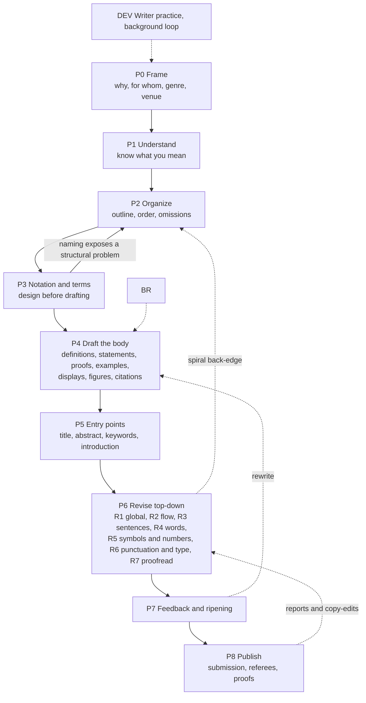

# Mathematical writing — process graph of rules

This skill gathers the rules about writing mathematics found in two sources (see §6): *Mathematical Writing* and *Writing Maths: Quotations*. The rules are arranged as a process graph: **phase nodes** (P0–P8) in the order work is done, each with its rules and an exit **gate**; **edges** for forward moves and the spiral back-edges of revision; **branches** for special genres; **support nodes** for refereeing (REF) and the writer's own practice (DEV); and **conflict edges** (⚖) where the sources disagree, each resolved in §5.

How to read a rule line: **ID** — rule. ✗ bad → ✓ good. [sources] · ⚖Cnn = sources conflict, resolution in §5 · ! = exception · → = related rule · † = reconstructed (see §6, Coverage).

## 1. Invariants — in force at every node

- **G01** Keep the reader uppermost: at each point ask what the reader knows so far, what they expect next, and why. [K§1.12, K§7, K§30, K§34, M-Trz, M-Tom]
- **G02** Do organize; do not distract. Anything that helps communication is good; anything that hurts it is bad. (Halmos checks four layers: semantics, syntax, symbols, style.) [K§42]
- **G03** Accuracy and clarity outrank style. [M-Kle, M-Viv, M-Wil]
- **G04** Aim at one realistic reader: a mathematician who can follow everything but does not work on your exact topic, is busy, and has not lived with your problem for months — someone you will never meet. Give them references, comments, and the extra explanation they need. [M-Trz, M-Tom, M-Kra, K§35]
- **G05** Write for the novice and you reach the experts; write only for experts and you reach nobody. Exposition aims at education, not showmanship. [K§10, K§30]
- **G07** Answer more questions than you raise. Be clear, coherent, accurate, concise — less is more. [K§41, K§37]
- **G08** Tone is the sum of tiny choices (which/that, commas, word choice); enough wrong ones cost attention and readers. [K§38]
- **G09** Style is personal: don't mimic a model or an adviser slavishly, don't shun a good convention just to be different, and don't apply any rule list slavishly — this one included. Break a rule deliberately when you want to jar the reader. [K§6, K§10, K§30, K§42, K§43, M-Wil, M-Trz]

## 2. The process graph

| Edge           | Traverse when                                                                                         |
| -------------- | ----------------------------------------------------------------------------------------------------- |
| P0 → P1       | reader, purpose, genre and venue are fixed (P0 gate)                                                  |
| P1 → P2       | main results can be stated plainly, why they hold is known, an example has been run                   |
| P2 → P3       | the outline lists every unit in a defensible order                                                    |
| P3 → P2       | naming the objects reveals a structural problem (an object needs its own section, two concepts merge) |
| P3 → P4       | the symbol and term table is stable                                                                   |
| P4 → P5       | the body is complete — write or finalize title, abstract and introduction last [M-Tom]               |
| P5 → P6       | a full draft exists (a first draft may break every rule [M-Hal])                                      |
| P6 ⇢ P2/P3/P4 | spiral: later material shows that earlier material should change [M-Hal]                              |
| P6 → P7       | every pass gate is met                                                                                |
| P7 ⇢ P4/P6    | critique demands rewriting                                                                            |
| P7 → P8       | outside readers and a rested reread are done; remaining issues are accepted knowingly                 |
| P8 ⇢ P6       | referee reports, copy-edits, proofs arrive                                                            |

Revision runs top-down because fixing structure first avoids polishing sentences that will be cut — fix the idea, not the sentence [K§31] — and because rules bite during revision, not during the first rush of drafting [M-Hal].

### Traversals — pick one

**A · Compose** (write new mathematical text from the user's content). P0: infer reader, genre and venue from the request; if the reader is unclear, state your assumption in one line rather than interrogating. P1: make sure you understand the mathematics — if a step is missing or false, say so instead of papering over it. Then P2 → P3 → P4 → P5, and run R1–R7 silently before delivering. Short pieces (one proof, one paragraph) compress to P1 → P3 → P4.3/P4.5 → R2–R7. Don't narrate the rules in the output.

**B · Revise or edit** (the user supplies text). Fix the scope first. A *light edit* ("fix the English", "proofread") runs R3–R7 and leaves structure and voice alone. A *substantive edit* ("improve", "make it clearer") runs R1–R7, where R1 re-checks the gates of P2–P5 and the rules of P4. Work top-down. Preserve the author's meaning, mathematics and voice (G09): change what breaks a rule or hurts the reader, not what merely differs from your taste. In Knuth's Scientific American saga, rewriting every sentence made good prose worse, while the editors' misreadings usefully exposed unclear passages (K§23–24). Never silently alter mathematical content; raise doubts as questions. For non-native writers, prioritize articles, agreement, prepositions, which/that, word order and idiomatic set phrases [M-Trz].

**D · Usage question** ("which or that?", "number every display?"). Find the rule by node; if it carries ⚖, apply the §5 resolution; answer with the rule, a ✗/✓ pair and the source.

**E · Coach a writer.** Combine targeted feedback on their text with DEV exercises and model texts.

**Severity** for reports, fixed in this order: **S1** meaning or correctness (wrong or unproved claims, false displays, missing hypotheses, circularity, ambiguity that changes meaning, uncredited copying); **S2** the reader cannot follow (organization, missing motivation, definitions or signposts, notation clashes); **S3** style and usage; **S4** mechanics and typography.

**Change-log line** (modes B and C): `S2 · §3 ¶2 · ST-02 — theorem relied on the standing assumption "X compact"; moved it into the statement.` Keep logs short; IDs are for traceability, not decoration.

## 3. Quick lint — the most-violated checks

Use for fast passes and as the final gate of P6.

1. A sentence starts with a symbol or numeral → reword (SY-02).
2. Two formulas separated only by punctuation → insert words (SY-01).
3. ∀ ∃ ⇒ ∴ ∋, iff, WLOG, s.t. in prose; symbols used as words ("is < 0") → words (SY-03, SY-04).
4. A display is unpunctuated, or preceded by a needless colon ("We have:", "let:") (DS-04, PU-02).
5. A restrictive "which" → "that"; search every "which" (WD-11).
6. A bare "this" or "it" without a clear referent → add the noun (SN-08).
7. "any" → each/every/some (WD-04); "Let" for a hypothesis → "Suppose" (WD-05); "Since …, then" → drop "then" (SN-13); "We have that x = y" → "We have x = y" and "Assume A is" → "Assume that A is" (SN-14).
8. A theorem that is not self-contained, starts with a symbol, or is mislabeled (lemma vs theorem vs corollary) (ST-02, ST-05, ST-01).
9. A proof by contradiction that could be direct; "Assume by contradiction" (PF-07, PF-08).
10. A proof's end is unmarked or marked inconsistently (PF-11).
11. One symbol with two meanings; a variable used before it is defined; a type not stated ("the set S") (NT-02, DF-02, SY-07).
12. Subscripted subscripts; needless symbols ("every continuous function f") (NT-07, NT-11).
13. Small counts as digits ("2 passes") or names as words ("Method two") (NU-01).
14. Hyphen vs en dash vs minus vs em dash; ellipsis dots and commas (PU-11, PU-09).
15. "i.e." or "e.g." without a comma, or confused with each other (PU-08, WD-10).
16. Illogical punctuation around parentheses; nested parentheses (PU-05, SY-10).
17. A citation used as a noun ("In [5] it is shown") (CI-05).
18. A figure that appears before it is mentioned, or has no caption (FG-03, FG-04).
19. Passive where active or imperative is clearer; a dangling modifier (SN-06, SN-07).
20. The text fails the blah test: read every nontrivial formula as "blah" — does it still flow? (DS-08)
21. A heading used as an antecedent ("2. Contour integration. This technique …") (RV-07).
22. An opening sentence that is technical or of the form "An X is Y" (IN-03, IN-04).
23. A title with symbols or abbreviations, or with no indication of the field (TI-01, TI-02).
24. Misspellings; its/it's, principle/principal, less/fewer, comprise/compose (PR-02, WD-10).
25. Contractions, fillers ("anyway", "pretty"), "very", "really" (SN-24, WD-03).
26. Mixed American and British spelling (WD-16); built-up fractions in running text (TY-03); missing ties at line breaks (TY-05).

## 4. Node catalog

P0, P1 and P7 carry gates only: their work is judgment, and the rules that serve them live in the invariants (§1), in DEV, and in the edge table above.

### P0 · Frame — why, for whom, in what genre, where

Gate: you can name the reader, the genre, the venue and the one thing the text must achieve.

### P1 · Understand — know exactly what you will say and why it is true

Gate: main results statable in plain words; the reason known; an example checked.

### P2 · Organize — decide content, order and emphasis

- **OR-02** Composition = organization + simplification. [K§34]
- **OR-03** Outline everything — each heuristic discussion, definition, lemma, theorem, corollary, remark and proof — in an order both logically correct and psychologically digestible. [M-Hal]
- **OR-04** Decide what to leave out as carefully as what to put in: too much detail discourages as much as none, and the secret of being boring is to say everything. [M-Hal, K§22]
- **OR-05** Build around the central, crucial examples and counterexamples. [M-Hal]
- **OR-06** Make the main result, its background and the plan of proof apparent early. [M-Kra]
- **OR-07** One idea at a time, in digestible portions. Follow a sequential path; if none exists, order logical units for understanding and independent units by importance to the main audience. Don't jump haphazardly, or make some details specific and others generic. [M-Kle, M-Gil]
- **OR-08** Explain a complex thing by splitting it into parts and explaining each part. [K§10]
- **OR-09** Keep each definition next to its uses (not defined in Chapter 2 and used in Chapter 5); repeating a definition beats sending readers hunting. [K§30]
- **OR-10** Keep material about one specialized structure together, so it is read while fresh. [K§11]
- **OR-11** Introduce each piece at the psychologically right moment — often the order in which you made the decisions — not the order a machine or formal system would need. [K§11]
- **OR-12** Respect dependencies: don't use a result before proving it unless you make the absence of circularity explicit; let proofs treat cases in the order of the definitions. [K§37, K§7]
- **OR-14** Let the structure of the text mirror the structure of the argument. [M-But]
- **OR-15** Factor long proofs: state the subgoal (the key property), then apply it; pieces with simple interfaces lighten what the reader must hold in mind. [K§21]
- **OR-16** Skeleton of a paper: title, abstract, (keywords), introduction, numbered and titled sections (often about six), (acknowledgements), references, and appendices for details or secondary audiences; number the pages; a short paper needs no table of contents or index. A conclusion is rare in mathematics — perspective, loose ends and open problems belong in the introduction, where more readers see them. [M-Kle, M-Gil]
- **OR-18** Prefer one running example (the same data through successive methods) or a sequence of examples that build on one another to a set of unrelated examples. [K§19, K§37]
- **OR-19** Don't open with a glossary of every term and symbol; introduce them in small doses, and put any glossary you need at the end. [M-Gil]

Gate: the outline covers every unit in a defensible order; definitions sit near their uses; omissions are decided; the main result is visible early.

### P3 · Notation and terminology — design before drafting

Ad hoc symbols chosen mid-sentence in the heat of composition are almost always bad [M-Hal].

- **NT-01** Design the notation at the start, as a system. [M-Hal]
- **NT-02** One symbol, one meaning; one meaning, one symbol — not "A_j for 1 ≤ j ≤ n" here and "A_k for 1 ≤ k ≤ n" there. Reuse a letter in a later proof only for an analogous role. [K§1.14, M-Hal, M-Kle]
- **NT-03** Use standard, familiar, suggestive notation and conventions the audience knows: lowercase elements in uppercase sets, i running from 1 to m and j from 1 to n, bold or arrows for vectors. [K§1.14, K§5, M-Gil]
- **NT-04** Keep notation harmonious: α, β, γ (✗ α, β, γ₁); ax + by or a₁x₁ + a₂x₂ (✗ a₁x + a₂y, ✗ ax₁ + bx₂). [M-Gil, M-Hal]
- **NT-05** Avoid near-collisions: an index set Σ beside a summation sign; ∈ (reserved for membership) vs ε (for ad hoc use); |x| < ε on one page and x ∈ S on the next. [M-Hal]
- **NT-07** Minimize subscripts: no subscripted subscripts or subscripted superscripts. Don't enumerate a set's elements unless you must — "S is countable", "elements x and y of X", not X = {x₁, …, xₙ} followed by x_{i₁}. Complicated notation breeds errors (Sierpiński's published proof had one). [K§1.15, K§5, K§20, K§21]
- **NT-08** Prefer words when they suffice ("the counterpart of α" instead of an indexed correspondence); avoid complicated alphabetic apparatus; the best notation is no notation — write as if speaking on a walk in the woods without paper. [K§21, K§22, M-Hal]
- **NT-09** But name what recurs: give a function you mention twice a name ("let f(x) = x²"), and name and conquer a repeated subexpression (v = c + ku, where k = cᵢ − cⱼ + 1). [M-Swa, K§5]
- **NT-10** Conversely, use a formula when it shows structure better than words (c/d² rather than "inversely proportional to the square of the distance"). [K§31]
- **NT-11** Omit irrelevant symbols: ✓ "Every differentiable real function is continuous." (✗ "… function f …") [M-Hal, M-Gil, M-Viv]
- **NT-12** Don't introduce in a theorem's statement notation that only its proof needs. [M-Gil]
- **NT-13** Choose representations that simplify statements (a sequence of ordered pairs rather than a pair of sequences). [K§21]
- **NT-14** Names must not mislead or resemble unrelated names; descriptive names can carry the exposition; let the part of speech fit the role (nouns for objects and data, verbs for procedures). [K§8, K§11, K§12]
- **NT-15** Coin terms with care — you may live with them forever (Knuth regrets "LR(k)"); an extended metaphor can name the parts of a complex construction (jellyfish: stems, polyps, tentacles); for an important concept, consult the community ("NP-complete" was chosen by poll). [K§25]
- **NT-16** Define every term you use — even basic ones in fields with inconsistent usage (path vs simple path vs walk) — and define no term you never use. [K§37]
- **NT-17** One term per concept across sections and co-authors (not "dominators" here and "parents" there); use in prose exactly the words used in the formal object — theorem, program, interface. [K§37, K§11, K§13]
- **NT-18** Avoid words that collide with another sense in the same text (airplanes beside complex planes; "left" in trees; chemical "solutions"); replace ambiguous terms ("loop" → "self-loop"). [K§37, K§41]
- **NT-19** Keep mathematical and programming notation apart: p_r, not p[r]; xy or x × y, not x*y. [K§4, K§11]
- **NT-20** Specify notation whose meaning varies by community (lg = log₂; the base of log). [K§24]
- **NT-21** Distinguish relations precisely: an element of a set vs a component of a vector; a factor (multiplied) vs a term (added). [K§4, K§37]

Gate: a symbol and term table exists; no symbol has two meanings; no subscripted subscripts; every needed term is defined and no unused one is.

### P4 · Draft the body

#### P4.1 Definitions

- **DF-01** Say important things twice, in complementary ways — formally and informally — especially definitions ("the subset of nonincreasing vectors"; "the smallest subset that contains C and is closed under addition of elements of P"). [K§1.11, K§10]
- **DF-02** Define every variable, at least informally, at or just before its first use. [K§1.11, K§5]
- **DF-03** Motivate definitions; a definition by decree is risky. [K§1.12]
- **DF-04** Global definitions (used throughout) highlight the defined term — boldface (now most common) or italics — and only the most important are displayed (the derivative, not "polynomial"). Local definitions ("Let f(x) = x²") need no highlighting; display them only if complicated. [M-Swa, M-Trz]
- **DF-05** Mark the term being defined: "We define the *convex hull* of E to be the smallest convex set containing E"; note the word order with "call": "We call the smallest convex set containing E the *convex hull* of E". [M-Trz]
- **DF-06** Write "if", not "if and only if", in a definition (tradition; "iff" is pompous outside logic). [M-Kle, M-Gil]
- **DF-07** A formal Definition only introduces terms or notation — no discussion inside it, no "Let" after the heading (✓ "Definition. |S| denotes the cardinality of S."); often it is better to weave definitions into the text. [M-Kle, M-Gil]
- **DF-08** Use := or =: so the colon marks the side being defined. [M-Trz]
- **DF-09** Action before definition is natural ("p(x) < p(y) for some x < y") — but don't hold back too much. [K§4]
- **DF-10** Slim intimidating multi-part definitions; collapse intermediate objects used nowhere else. [K§37]
- **DF-11** "Shall" in definitions sounds stiff to younger readers; use the present tense. [K§5]

#### P4.2 Statements — theorem, proposition, lemma, corollary, remark

- **ST-01** Label by role: theorem = major result (use sparingly); proposition = lesser result of independent interest; corollary = follows with little proof from a theorem, proposition or corollary; lemma = auxiliary result for a proof (stated and proved before use; a lemma has no corollaries); remark = brief aside on which the main line does not depend. [M-Kle]
- **ST-02** Make statements self-contained: every hypothesis inside, no reliance on standing assumptions in the surrounding text, so a reader who opens the paper at that theorem understands it. [K§1.5, M-Tom]
- **ST-03** State the theorem first, then prove it; don't ramble and then announce "Thus we have proved …" — readers follow a proof better, and see where hypotheses are used, when they know the goal. [M-Hal]
- **ST-04** The sentence before a theorem or algorithm is a complete sentence or ends in a colon — better, it motivates the result and ties it to what came before. ✗ "We now have the following / Theorem. H(x) is continuous." ✓ "We can now prove the following result. / Theorem. The function H(x) defined in (5) is continuous." [K§1.4]
- **ST-05** Start statements with words, not symbols ("The matrix X₁ satisfies …"). [K§1.4, M-Hig]
- **ST-06** Strip notational abbreviations and convoluted cross-references from statements — skimmers read only the statements. [K§27]
- **ST-07** Make the status of every assertion clear — proved, to be proved, conjectured, or left to the reader — and announce a proof before the claim: ✓ "We now prove that (12) implies A = B. To see this, …" (✗ "By (12), A = B. To see this, …"). [M-Trz, M-Kle]
- **ST-08** For a nonstandard result whose proof you omit, cite just before the statement or after its heading ("Theorem 5.1 [2, p. 202]"), and say whether the omitted proof is easy or hard. [M-Kle]
- **ST-09** Call named theorems by name ("by the Fundamental Theorem", not "by Theorem 5-1"); capitalize numbered labels: Theorem 1, Lemma 2, Algorithm 3, Method 4. [M-Kle, K§1.19, K§5]
- **ST-10** A lone theorem needs no number. [M-Hig]
- **ST-11** Show that hypotheses are needed: give a counterexample for each condition that cannot be dropped. [M-Hal, K§3]
- **ST-12** Illustrate a theorem before proving it — or instead of proving it, if the illustration carries the essence or the proof is beyond the audience. [M-Gil]
- **ST-13** Explain why a result is true before stressing its significance; readers sit waiting for the "why". [K§7]
- **ST-14** Don't call theorems "equivalent" (every theorem is true); equivalence is a relation between conditions. [M-Hal]

#### P4.3 Proofs

- **PF-01** Write for a competent, concentrated reader: give enough to make the result believable and to let them fill in details with confidence; skip arguments obvious to every mathematician and purely routine computations that involve no trick. [M-Trz, M-Gos, M-Gil]
- **PF-02** Prefer conceptual to computational proofs; open an involved proof with its idea or strategy — "essentially a diagonal argument" orients the reader at once. [M-Gil, K§21]
- **PF-03** Keep the reader synchronized with goals, subgoals and strategy: "only P ⊆ Aₙ remains to be verified"; "we want to show that this leads to a contradiction"; "the lemma is half proved"; "we divide the proof into two parts". Coin vocabulary that helps ("a witness to the unsortedness of P"). [K§3, K§4, K§5]
- **PF-04** Say what is going to happen before it happens and what has happened afterwards; summarize at the end of a long argument; break long proofs into digestible pieces. For long or delicate arguments, consider a structured proof.
- **PF-05** Explain why, not just what: justify each step, tie every new variable to earlier ones, introduce no symbol out of nowhere, keep referents stable. ✗ "An odd integer leaves remainder 1 when divided by 2; divided by 4 it leaves 1 or 3, so the number is 4n + 1 or 4n + 3." ✓ "Write the odd integer as 2m + 1. If m = 2n, it equals 4n + 1; if m = 2n + 1, it equals 4n + 3." [M-Eri]
- **PF-06** Blend words and notation — grammatical sentences in which some terms are symbols — and use the notation you set up instead of lapsing into words only. [M-Eri]
- **PF-07** Prefer a direct proof to a proof by contradiction. Contradiction is the natural first route but rarely the best exposition (prove linear independence directly: "if Σcᵢvᵢ = 0, then every cᵢ = 0"); a direct proof often proves more. [K§3, K§42, M-Kle]
- **PF-08** If you do argue by contradiction, announce it naturally — "To prove X, let us assume the opposite and see what happens" — not "Assume by contradiction that …". [K§5]
- **PF-09** Treat base or empty cases explicitly where readers may stumble (initialize a recursive construction). [K§21]
- **PF-10** Omit similar cases with a note: "The analysis of case (b) is similar." [M-Trz]
- **PF-11** Don't belabor the finish ("Since we started with an arbitrary odd integer …, we are done"). Mark the end — "This completes the proof." or □ — the same way in every proof; leave a space between □ and a final period; set statement and proof off with white space. [M-Eri, M-Kle, M-Gos, K§5]
- **PF-12** Be chatty before a proof, lean inside it, chatty again after it (Wilf). [K§27]
- **PF-13** Keep relations in the visual order of their indices: after "i < j", write pᵢ < pⱼ, not pⱼ > pᵢ. [K§5]
- **PF-14** Avoid facile generalizations — mechanical extensions that add no insight — and resist generalizing to n dimensions when the three-dimensional case teaches better. [K§16, K§34]
- **PF-15** When teaching heavy machinery would cost more pages than applying it, keep the level down: do the basic calculations, cite the deep results ("it can be shown [ref] that …"). ⚖C15 [K§30]

#### P4.4 Examples

- **EX-01** Use many examples — in expository work, more examples than definitions and theorems; one solid example beats a dry, abstract paper; you can hardly have too many. Particulars persuade; generalities are necessary evils. [M-Swa, K§31, K§30, K§43]
- **EX-02** Lead with a very simple example — it carries three quarters of the idea, and no example is too simple, at least in a lecture — then a richer one with all the grubby details. Each example should show all and only the points at issue; finding such examples takes real time. [K§30, K§31]
- **EX-03** Prefer real data to cooked-up sample data. [K§12, K§18]
- **EX-04** Brief examples go in-line; long or key examples are displayed and numbered. [M-Swa]
- **EX-05** Pose a hard problem first as a puzzle-like example: solving it builds the right mental structures for the algorithm or proof that follows. [K§25]
- **EX-06** A few failed attempts motivate, but the device palls quickly; don't spring mysteriously convenient starting points ("Consider the following …" from left field). [K§27]
- **EX-07** Simplify first, then repay the truth: present a straightforward version — even a small lie, or a simplified system invented for exposition — and add the correct details later; 80% of the truth for 20% of the difficulty. [K§34]
- **EX-08** Use analogies only when you are sure the reader will get the point. [K§30]
- **EX-09** A good illustration can convince more than a complete proof; keep the verbs honest — prove (strict), show (looser), illustrate (by example). [M-Swa]

#### P4.5 Displays

- **DS-01** Display important formulas on their own lines: formulas longer than about ¾ of a line; those with tall elements (fractions, matrices, sums, integrals) unless very simple; definitions used pages later; pairs of analogous formulas to be compared. [K§1.16, M-Trz, M-Swa]
- **DS-02** Don't display short formulas the reader won't revisit, or the same formula twice nearby. Never display a false equation — eyes treat displays as gospel — keep it in the text, flagged ("so the equation '…' is always false"). [M-Trz, K§7]
- **DS-03** Number a display if you refer to it beyond the next few lines, and number the few key formulas readers will want to cite; never number them all. ⚖C01 [M-Swa, M-Gil, K§1.16, K§4]
- **DS-04** Displays belong to sentences: punctuate them as if they were in-line (commas between clauses, a final period); put no colon before a display that simply completes the sentence (✗ "let: L(C, P) = …"). [M-Swa, M-Kle, M-Tom, K§1.23, K§5]
- **DS-05** Align multi-line displays on the main relation (=, ≤, ⇒); continuation lines may carry only a right-hand side. [M-Swa]
- **DS-06** Break long formulas at logical points — before the relation or operator in a display, after it in running text. The author should decide, even changing the mathematics (a new symbol) to get a good break; moving a formula from text to display can allow a cleaner split. [K§8]
- **DS-07** Never list formulas homework-style: give a running commentary, define terms as they appear, state assumptions about validity, add examples; explain nontrivial steps before, between or after the lines (elementary algebra needs no comment). [K§1.10, M-Kle, M-Swa]
- **DS-08** Blah test: the text must flow when every nontrivial formula is read as "blah" — many readers skim formulas at first. [K§1.13]
- **DS-09** Choose the clearest of the equivalent forms (reorder to avoid a confusing leading minus sign) and propagate the change through the text. [K§7]
- **DS-10** Pick one typographic variant (integral limits beside the sign, or above and below) and keep it throughout. [K§7]
- **DS-11** Balance the page: neither solid prose (a sermon) nor a page of symbols (hash); intersperse displays so the eye can help the brain; embed symbols in enough prose. [M-Hal]
- **DS-12** Make paragraph starts unmistakable around displays; keep a display from splitting across pages (rewrite nearby text if needed). [K§5, K§7]

#### P4.6 Figures and tables

- **FG-01** Draw what words describe badly — data structures, algorithms as graphs, nested boxes instead of trees, state diagrams. Keep diagrams small and focused (no spaghetti chart of everything), though a large, well-made chart can earn its place and can reveal what analysis misses. [K§18]
- **FG-02** Detail is fine if readers who don't want it can ignore it; the main message must be visible at a glance. ⚖C17 [K§18]
- **FG-03** Number every figure and table, mention it in the text first, and place it shortly after — never before — that mention; or put all figures at the end and say so at the first mention. Refer to "Figure 5.1" (capitalized, roman) and number in order of first mention. [M-Swa, M-Kle, K§14]
- **FG-04** Caption every figure so it says, independently of the text, what it shows and how it differs from its neighbors, without excessive detail; make text and picture agree. [M-Kle, M-Swa]
- **FG-05** Put the explanatory text next to (opposite) its diagram. [K§19]
- **FG-06** Don't mislead with graphics: drawing a one-dimensional quantity as a two- or three-dimensional picture exaggerates it (Huff; Tufte). [K§18]
- **FG-07** Tables of numbers can show what graphs cannot (an oscillation, say); a listing of events conveys asynchronous processes. [K§18, K§19]
- **FG-08** Budget for illustrations (production work grows steeply with their number) but use them where indispensable; color helps in talks, rarely in print; tell the printer when a figure is deliberately bad. [K§19, K§18]

#### P4.7 Citations and credit

- **CI-01** Credit original discoverers; cite the first publication of recent results; classical results (calculus, say) need no original references except in historical writing. [M-Swa]
- **CI-02** Don't cite a textbook for standard definitions or theorems. Widely used descriptive names ("Chain Rule") are common property; sequential names ("Theorem 6", "Limit Rule II") are local to one text — cite them with a page, or better, state the result. [M-Swa]
- **CI-03** Credit direct and near-direct quotations, and examples taken with their exact words or numbers; paraphrase of common mathematical knowledge needs no credit; if your whole approach follows one source, say so once near the beginning ("In writing this paper, I have drawn heavily on …"). [M-Swa]
- **CI-04** Plagiarism: ideas cannot be copyrighted, expression can — never present copied passages, runs of equations or a distinctive presentation as your own; quote explicitly in surveys; credit previously published exercises.
- **CI-05** Citations are parenthetical: the sentence must read correctly without them. ✗ "In [Smith 80] it was shown …" ✗ "Knuth [Knuth 83] has shown …". Put a space before the bracket. [K§37]
- **CI-06** Use bracketed keys with locators after a comma — [5, Section 3.7, p. 9]; the sentence's period comes after the bracket; no footnote citations; no loc. cit., op. cit. or ibid. [M-Kle]
- **CI-07** Reference list: complete data for every cited source; full page ranges of articles, not the pages you cited; the journal's format and one ordering (alphabetical or by citation) throughout — e.g., MAA style: journal abbreviations as in Mathematical Reviews, bold volume numbers, uninverted author names, "pp." for books only. Spelled-out journal names help novices; include a conference's place and date (libraries index by city).
- **CI-08** Check every citation against the original; never copy citation data from other bibliographies — errors propagate (Berlekamp found nearly half of them wrong). Verify the attribution of quotations too. [K§14, K§22, K§43]
- **CI-09** Give page numbers only for remote cross-references; nearby, "by (5.14)" is enough. Author–year (unnumbered) keys survive insertions; rephrase citation sentences when the text moves to a new context (paper → book). [K§7, K§37]
- **CI-10** Acknowledge every contributor and co-author (young authors often forget). Thanks and grants go in an Acknowledgements section before the references, not in asterisk footnotes on the title or author's name — the first pages decide whether anyone reads on. [K§18, M-Trz]

Gate: every statement self-contained and labeled by role; every proof announces its strategy and ends visibly; every display punctuated; every figure mentioned and captioned; every nonstandard claim proved or cited.

### P5 · Entry points — title, abstract, keywords, introduction

Most readers see nothing else, and decide on these alone [M-Tom, M-Trz]; write or finalize them after the body [M-Tom].

**Title**

- **TI-01** Give an informative, concise title that names the branch of mathematics and the distinctive feature — neither too long nor too general (✗ "On a theorem of Kuratowski"). [M-Swa, M-Kle, M-Trz]
- **TI-02** No formulas, complicated symbols, special typefaces, abbreviations or macros: they garble bibliographies, retrieval systems and indexes. A title that starts with a symbol can be rescued by prefixing words ("The Editor's Corner: n Coins in a Fountain"). [K§4, K§25, M-Trz, M-Kle]
- **TI-03** Don't rely on a concept defined only inside the paper, and check for ambiguity (✗ "Optimal Font Caching" — optimal fonts, or optimal caching?). [M-Swa, K§16]
- **TI-04** Lively forms attract readers: a question ("Can a graph be continuous and discontinuous?"), the main result as a sentence, a gerund or participle ("Computing …", "… revisited"). [K§27, M-Trz]
- **TI-05** Capitalize according to the venue — commonly every word except articles, coordinating conjunctions and prepositions that are neither first nor last — and consistently. ⚖C13 [M-Ale]

**Introduction and conclusion**

- **IN-01** Most people read only the introduction and skim the theorems — invest accordingly. [M-Tom, M-Trz]
- **IN-02** Put everything up front: say in plain English what the paper does, so readers can decide whether they care (Wilf: you can quintuple your readership). [K§27, M-Kra]
- **IN-03** Make the first paragraph your best paragraph and its first sentence your best sentence: nontechnical, simple, direct, without passive wimpiness, readable by any mathematician — then keep it up. ✓ "Would you guess that most continuous functions are nowhere differentiable?" ✗ "Consider a sheaf of germs of holomorphic functions." [K§1.24, K§31, M-Gil, K§27]
- **IN-04** Don't open with "An X is Y". ✗ "An important method for internal sorting is quicksort." ✓ "Quicksort is an important method for internal sorting, because …" [K§1.24]
- **IN-05** Don't open with definitions and notation; open with the fundamental problem, a question, or history — precision can wait until attention is caught. [M-Trz, M-Gil]
- **IN-06** Cover the precise subject; how it arose, where it is headed, how it relates to other subjects and why it matters; your main theorems (they may be restated later with the same or new numbers); the relevant literature, citing a good survey or two; the organization of the paper by section number. Optional: proof ideas or sketches, a chart of dependencies between sections, open problems. Give enough background for the whole paper and no more; background for one section goes into that section. [M-Kle, M-Trz]
- **IN-07** Sell the work, but humbly: no superlatives about your own results; for others' work, give reasons instead of a bare "interesting" or "remarkable". [M-Tom, K§1.12]
- **CO-01** Usually omit a conclusion; if you include one, give perspective, tie loose ends and suggest research — don't mirror the introduction. [M-Kle]

Gate: the title passes TI-01–TI-03; the abstract is one symbol-light paragraph; the first paragraph is readable by any mathematician; the introduction states the results and the organization.

### P6 · Revise — passes R1 to R7, top-down

Each pass has a gate; failing a later gate may send you back up the graph. R6's typographic rules apply only where the user controls typesetting (LaTeX source, final proofs).

#### R1 · Global and logic

- **RV-01** Revision is the most important part of the job; nobody writes perfect mathematics the first time. Rewrite for accuracy, precision and clarity. [M-Eri, K§34]
- **RV-02** Spiral plan: write and rewrite in the order 1, 2, 1, 2, 3, 1, 2, 3, 4, … at every scale — chapters, sections, paragraphs, sentences, words. [M-Hal]
- **RV-03** Rewrite rather than patch: piecemeal insertions and deletions invite blunders; fix the idea, not just the sentence; a horrid sentence may need its whole paragraph rebuilt (e.g., moving a key term earlier). [M-Hal, K§31, K§43]
- **RV-04** Challenge every word, phrase, sentence, paragraph and section: Is the order right? Why this word? Can verbiage be trimmed? Can explanations and proofs be clearer? [M-Fla]
- **RV-05** Check that each sentence makes sense and the logic makes common sense; that each paragraph has one topic and consists of complete, punctuated sentences; that each step follows from the last and each leap is justified; that the progression matches the argument. [M-Eri, M-But]
- **RV-06** Hunt logical omissions: every claim proved, cited or explicitly deferred (e.g., an iteration said to converge with neither proof nor reference). [M-Hig]
- **RV-07** The text must read correctly with the headings deleted; a heading is a marginal note, not an antecedent. ✗ "2. Contour Integration. This technique, invented by Cauchy, …" ✓ "2. Contour Integration. The technique of integrating along curves in the complex plane, invented by Cauchy, …" [K§37]
- **RV-08** Re-run the gates of P2–P5 and the rules of P4 on the whole draft. [all]
- **RV-09** Review in different media — longhand, screen, typeset page; each pass shows different faults. [K§6]
- **RV-10** If you have to think long about whether a sentence is right, it is probably wrong. [K§43]
- **RV-11** Throw drafts away when needed: treat them as sketches (books and programs often improve by starting over). But stop — a work is never finished, only abandoned; don't wait for one more result or chase one more polish ("never spend more than a year on anything"). [K§34, K§6, M-Hal, K§30]

#### R2 · Flow and the reader model

- **FL-01** Simulate the reader: what do they know at this point, what are their primitives, what do they expect next? Keep background "daemons" running that ask "how will the reader misunderstand me here?", and add guideposts where they would. [K§7, K§34]
- **FL-02** Read at normal speed — and aloud — to judge rhythm; the finished text should read so smoothly that no one suspects it was rewritten. Many words mean "therefore", but often only one has the right rhythm ("merge patterns" vs "merging patterns"). [K§7, K§1.7, K§5, K§41]
- **FL-03** Motivate what follows: say where you are going and why the next fragment is worth reading. [K§1.12, M-Trz, M-Kra]
- **FL-04** Use a conversational tone with signposts and transition paragraphs, blending formal and informal discussion. [K§5, K§25]
- **FL-05** Open each paragraph with a topic or transition sentence and end it with the conclusion you want remembered; avoid one-sentence paragraphs and paragraphs over about 200 words. [M-Wil]
- **FL-06** Pace deliberately: split paragraphs; turn semicolons into periods to slow down, or occasionally periods into semicolons for a quick run; a sentence may begin with "And" if it is clearly built. ⚖C16 [K§8, K§41]
- **FL-07** Vary sentence openings and connectives — avoid chains like "Thus … Consequently … Therefore … And so …" or "and then … and then …" — but keep strict parallelism for parallel ideas. Do this while polishing, not while drafting. ⚖C04 [K§1.9, K§5, M-Tom, M-Kle]
- **FL-08** Make results findable for skimmers: clear theorem statements, informative headings, a boldface summary of the results. [K§27]
- **FL-09** Let enthusiasm show — it motivates readers — within the genre's limits. [K§31, K§11]
- **FL-10** Humor works best when getting the joke requires understanding the technical point; it must survive rereading (and ten years in a journal); jokes are dangerous in journals. [K§1.27, K§31, K§15]
- **FL-11** A guiding conceit (theme, metaphor) may catalyze writing but must not intrude; drop it if it does. [K§31]
- **FL-12** Readers forgive weaknesses surrounded by strength; let strong material carry the unavoidable weak spots. [K§35]

#### R3 · Sentences

- **SN-01** Keep most sentences short and simple; split long, involved ones; don't write one long sentence where two short ones do. ✗ "We note the fact that the polynomial 2x² − x − 1 has the coefficient of the x² term positive." ✓ "The polynomial 2x² − x − 1 has positive leading coefficient." [M-Viv, M-Kle, M-Wil, K§41]
- **SN-02** Aim for an average under about 20 words per sentence with real variety: in ten consecutive sentences, nine or ten different lengths, roughly bell-shaped around 15–18 words, including some short, punchy sentences and a few long ones. [K§35]
- **SN-03** Control emphasis: the start and end of a sentence are emphatic, the middle is a slum. Put old, linking information first and the new point last; don't let a side phrase steal the focus; long sentences de-emphasize, so never bury the crucial point in one. [K§35, M-Wil, K§41]
- **SN-04** Put the subject early and the verb right after it; keep subject and verb close; express the action in the verb; subject–verb–object is a safe default. [M-Wil, K§41]
- **SN-05** Make sentences parse left to right without garden paths or loose modifiers: ✓ "We prove that the two conditions A and B imply C" (✗ "We prove that A and B implies C"); ✗ "In the theory of rings, groups and other algebraic structures are treated"; ✗ "fine book collectors" (fine books or fine collectors?). [K§1.17, K§5, K§41]
- **SN-06** Prefer the active voice: "we" (reader and author together) or, often better, imperative and indicative constructions — "Multiply each Δz by this factor"; "Solving the equation yields real roots" (✗ "By solving the equation, it is found that the roots are real"); "A consequence is the following result." or even "Consequence: A implies B." [K§1.6, K§42, M-Kle, M-Gil, M-Wil, M-Viv]
- **SN-07** No dangling participles or modifiers: ✗ "Solving the equation, the roots are real." [M-Kle, K§1.20, K§41]
- **SN-08** Make every pronoun's antecedent unmistakable — especially it, this, which, they. Never use a non-referential "this" (✗ "This leads us to consider …" → "This construction leads us …"; "This is done by" → "This step is done by"); recast "It is …" sentences when "it" could mean an object under discussion. [K§7, K§8, K§30, K§41, M-Kle]
- **SN-09** Tense: either present tense throughout, or sequential narration ("we saw", "we will prove"; long works add duration words such as "long ago", "soon"). Present tense for timeless facts (an algorithm's worst case *is*), past tense for superseded claims or past states of knowledge; don't mix tenses or voices on one subject (✗ "Let X be compact; we shall define H(X), and then K(X) can be defined"; ✓ "We assume X, hoping to reach a contradiction"). [K§4, K§7, K§8, K§37, K§5, M-Fla]
- **SN-10** Prefer the present indicative and the imperative; don't overuse the subjunctive, future or conditional. [M-Fla]
- **SN-11** Write complete sentences (fragments only in captions and titles); make subjects agree with verbs ("The set of primes is infinite"; "Each of the Δz is"; "This number plus that number is"; "these two relations") and pronouns with antecedents ("Each function … its derivative"); respect case ("I don't know who is the President"; never "whomever said that"). Nonstandard grammar distracts readers from what you say. [M-Viv, K§24, K§41, K§42, M-Hig]
- **SN-12** Recast stacked conditionals (✗ "If p, then if q, then r" → "If p and q, then r") and afterthought "where" clauses (✗ "If n is sufficiently large, then |aₙ| < ε, where ε is a preassigned positive number" → ✓ "If ε is a preassigned positive number and n is sufficiently large, then |aₙ| < ε"). [M-Hal]
- **SN-13** "Since …" takes no "then": ✓ "Since this limit exists, the series converges." After an assumption, use "then", not "therefore": ✓ "Assume x = 3. Then 2x = 6." [M-Gil]
- **SN-14** Use "then" after "if" in mathematical statements ⚖C08. Keep "that" where it aids parsing — "Assume that A is a group"; "assume" and "suppose" take "that" unless another "that" is near — but never write "We have that x = y" ⚖C07. [M-Hal, K§43, K§1.8]
- **SN-15** Place "only" and "also" next to what they modify (✓ "We calculate the positions of only two vertices"), shifting them while editing for flow; choose "all" or "all of" by ear. [K§41, K§6]
- **SN-16** Give parallel ideas parallel form: ✓ "Formerly, science was taught by the textbook method; now it is taught by the laboratory method." Adjacent sentences built alike signal similarity. [K§1.9, K§35]
- **SN-17** Don't stack nouns or adjectives in front of a noun ("the packet switched data communication network protocol problem"); use prepositional phrases, clauses or two sentences. [K§1.26, M-Kle]
- **SN-18** Use verbs, not ponderous nouns: "to prepare" (✗ "for the preparation of"); "We remove the spaces because …" (✗ "The reason for removing the spaces is that …"). [M-Gil, K§41]
- **SN-19** Cut padding: "because of the fact that" (unless the reader needs a breather after a dense passage), "the fact that", "it is noted that", "nine out of ten" (→ "nine of ten"), noise phrases like "in the context of" (unless repeated on purpose to re-signal a topic). Unwind convoluted logic into a direct statement; bloated prose can often lose half its words. [K§1.8, K§41, K§37, K§31]
- **SN-20** Make "instead" contrasts explicit: "when x = −1 instead of +1". [K§7]
- **SN-21** Don't repeat a word within a sentence ("approach the values … fill in the entries"); space out sticky words (this, also, then, just, they, and unusual or polysyllabic words); never echo an unusual word in unrelated passages — readers will connect them. [K§7, K§1.9, K§42, K§41]
- **SN-22** Split an infinitive only when the unsplit order is awkward or misplaces the emphasis ⚖C05. Ending a sentence with a preposition is fine, except in doubled constructions ("which such sentences end with") ⚖C06. [M-Viv, K§43, K§42]
- **SN-23** Know which constructions are unusual (an independent clause followed by a parenthetical independent clause, say) and don't repeat them back to back. [K§35]
- **SN-24** Keep a formal register: no contractions, conversational fillers ("Anyway, …", "pretty straightforward") or text-message abbreviations. Be forthright and friendly without needless formality; the impersonal "one" is stiff and rare today; state things positively. [M-Tom, M-Ale, K§41, M-Viv, M-Kle]

#### R4 · Words and usage

- **WD-01** Choose plain, exact words: no fancy, witty or affected words, scare quotes, clichés ("last but not least"), foreign phrases or nonstandard jargon; use standard technical terms correctly. Even specialists enjoy a nonspecialist's vocabulary. [M-Trz, M-Ale, M-Wil, K§1.26]
- **WD-02** Use only words whose meaning you know exactly (simplistic ≠ simple). Keep a large dictionary, a usage dictionary and a thesaurus at hand — the thesaurus for recalling a word, avoiding repetition and coining names. [M-Viv, M-Trz, K§9, K§35]
- **WD-03** Cut vague and emphatic words — real, nice, important, good, bad, extremely, quite, very (keep a "very" only where you would happily write "damn"), really, literally, in fact — and use adjectives sparingly. Name the actual criterion instead: "where the extra work most improves the picture", not "where it is really needed". ✗ "The proof is very easy, as it makes a quite elementary use of the triangle inequality." ✓ "The proof uses the triangle inequality." [M-Ale, M-Viv, K§40, K§41]
- **WD-04** Never use "any": it can mean "every" or "some". Write each, every or some, or recast. [M-Hal]
- **WD-05** "Let" fixes a convention under our control ("Let f(x) = x²"); "suppose" or "assume" introduces a hypothesis ("Suppose f′(x) > 0", not "Let f′(x) > 0"). [M-Swa]
- **WD-06** Use "thus", "so" and "hence" only when what follows is a logical consequence of what precedes. [M-Swa]
- **WD-07** Use precise mathematical nouns and verbs: x − 3 < 0 is an inequality and x² − 1 = (x − 1)(x + 1) an identity, not "equations" (a formula may be a relation, definition, statement or theorem); [0, ∞) is a ray or infinite interval; "a solution" unless it is unique; "the function f", not "the function f(x)"; "the image f(A)"; the area of the unit disc, not circle; |z| is nonnegative, not positive; the real and imaginary parts, not the coordinates, of a complex number; the graph of exp meets the ordinate axis; "defined by" for a definition, "denoted by" for a name. [M-Viv, K§4, M-Hig]
- **WD-08** Distinguish a function from its value; be logically exact ("not nonincreasing" ≠ "increasing"). [M-Hal, K§5]
- **WD-09** Use articles and prepositions deliberately: "a" vs "the" carries existence and uniqueness; prose without articles is not understandable; "a vertex at distance d", not "of distance d". [M-Trz, M-Viv, K§37]
- **WD-10** Confusables: comprise means embrace — the whole comprises all its parts (ℝ comprises the rationals and irrationals; ℝ does not comprise the rationals; ✗ "is comprised of" → "is composed of"); test by substituting "embrace"; i.e. (that is) vs e.g. (for example); principle vs principal; its vs it's; fewer (count) vs less (amount); alternately vs alternatively; imply vs infer; disinterested vs uninterested; complement vs compliment vs component; decimate; "where" means in or to which (✗ "the logarithmic function, where the derivative is positive" → "whose derivative"); no "is when" in definitions (✓ "A prime number is an integer with …"); "hopefully" as a sentence adverb irritates many readers, so avoid it; "due to" for credit ("a theorem due to Cauchy"), "because of" for causes; "if" rather than "assuming that"; "by changing — to —" instead of the clumsy "by replacing — by/with —". [M-Gil, M-Viv, K§41, K§42, K§40, K§43, K§7, K§11]
- **WD-11** which vs that: "that" restricts and takes no comma; "which" adds information after a comma, follows a preposition, or asks a question. If "that" can replace "which", replace it; search the file for every "which" before submitting. A needless "which" sounds nervous. ✓ "The lawn mower that is broken is in the garage." ✓ "The lawn mower, which is broken, is in the garage." ⚖C10 [K§1.22, K§38, K§37, M-Viv, M-Gil]
- **WD-12** Latin and Greek plurals: data, criteria, phenomena, maxima, minima, extrema, curricula, media, symposia ("these data are"; "that criterion is"). Where a copy editor disputes the agreement, reword (PB-05). [M-Gil, K§24]
- **WD-13** Avoid biased language, and pick the least distracting generic pronoun for your actual readers. ⚖C12 [M-Ale, K§42, K§40]
- **WD-14** Weigh connotation and register: "one hopeful sign" (signs are not hopeful); vulgarisms and hoity-toity words both shift the tone. [K§41, K§35]
- **WD-15** Field idioms ("reference" as a verb; an object that "witnesses" a property) suit insiders and jar everyone else — know your audience. [K§42, K§41]
- **WD-16** Spell consistently in one dialect (American or British; -ize or -ise), following your dictionary's preferred spellings and mixing only in proper names ("the labor of the British Labour Party"). [K§9, M-Hig, K§43]
- **WD-17** Prefer "the proof above" to "the above proof", and "at most" or "at least" to "less than or equal to" where natural. [K§43]
- **WD-18** When a distinction such as imply/infer is widely blurred and your audience is large, don't rest anything important on it. [K§42]

#### R5 · Symbols and numbers in prose

- **SY-01** Separate the formulas of a sentence with words. ✗ "Consider S_q, q < p." ✓ "Consider S_q, where q < p." ✗ "Add p k times to c." ✓ "Add p to c, repeating this process k times." (In a display, spacing may do the separating: aₙ = bₙ,  n < 5.) [K§1.1, K§5, M-Viv]
- **SY-02** Don't start a sentence with a symbol or numeral: ✓ "The polynomial xⁿ − a has n distinct zeros." ! Terms such as C*-algebra or K-theory may open a sentence; so may answers to exercises in a book's answer section. [K§1.2, K§11, M-Tom, M-Viv, K§8]
- **SY-03** In prose, write out ∴, ⇒, ⇔, ∀, ∃, ∋, iff, WLOG and s.t. (logic papers excepted). ∈, relations, operations and named sets such as ℝ are acceptable once defined. Formula soup quantified with ∃ and ∀ loses to a sentence. [K§1.3, M-Tom, M-Su, K§1.26]
- **SY-04** Don't use symbols as words: ✗ "The number √2 − 3/2 is < 0" → "is negative"; ✗ "every number on the left < every number on the right"; ✗ "If a is an integer ⇒ a is rational." [M-Gil, M-Viv]
- **SY-05** A sentence with formulas is still a complete, punctuated sentence: ✗ "x² − 121 = 0. x = ±11." ✓ "The equation x² − 121 = 0 has two solutions: x = ±11." [M-Viv]
- **SY-06** Don't overload one formula: ✓ "Set Δ = b² − 4ac. If Δ ≥ 0, then the roots are real." (✗ "If Δ = b² − 4ac ≥ 0, then …") [M-Viv]
- **SY-07** State each symbol's type when it appears: "the set S", "the integer n". [K§30]
- **SY-08** Remind readers of notation unused for several pages (or paragraphs); leave no free variables; write index ranges in full (Σ from i = 1 to n). [M-Hal, M-Hig]
- **SY-09** Plurals and possessives of symbols: prefer "each Hⱼ" to "the Hⱼ's", which clashes with primes; a possessive needs its apostrophe. [K§37]
- **SY-10** Drop needless parentheses ("let k be cᵢ − cⱼ + 1") and nested ones ("(Definition 2)", not "(definition (2))"); don't turn outer parentheses into brackets or braces — those carry mathematical meaning. [K§4, K§5, K§24]
- **SY-11** Disambiguate number words: "when x is one" (pronoun or numeral?) → "when x = 1"; "the number of solutions is two or three" but "the only solutions are 2 and 3"; if a style forces digits into words, "unity" avoids the pronoun "one". [K§42, K§16]
- **SY-12** Put paired indices in alphabetical order ("the mth and nth positions") and relations in the order readers visualize (PF-13). [K§12, K§5]
- **NU-01** Spell out small numbers used as counts or adjectives ("four solutions", "requires two passes"). Use numerals for numbers used as names or specific values ("Method 2", "17 passes", "Both 3 and 5 are prime", "modulus 1"); with units, ages, dates, times, pages, percentages, money and ratios; and for all the numbers in a passage that contains several. Never start a sentence with a numeral. [K§1.18, M-Viv, M-Ale, M-Hig]
- **NU-02** Write decimals as numerals (0.25; "0.5 kilogram", singular); hyphenate number–unit modifiers ("a 3-month-old experiment"); keep a number and its unit on one line. [M-Ale]
- **NU-03** Large numbers: 1000000 or 10⁶ in formulas; thin-space groups (1 234 567) in high-precision tables; commas only in running text. [K§24]
- **NU-04** Express dates in parallel terms ("late in the 1500s … in 1637", not "late in the 16th century … in 1637"). [K§43]

#### R6 · Punctuation and typography

- **PU-01** Punctuate formulas, in-line or displayed, as parts of their sentences. [M-Tom, M-Kle, M-Swa]
- **PU-02** Colons: fine before lists and after "as follows"; never directly after a main verb or before a formula that completes the sentence ("We have: …"); don't let colons outnumber periods. Capitalize after a colon only if a full sentence follows. [K§5, K§1.23, M-Ale]
- **PU-03** Commas: where a speaker would pause for breath; enough to parse (a comma before "because" in a long sentence), and no more (Knuth puts none after an initial "Therefore"). None around a restrictive appositive ("a directed graph G"); a pair around a nonrestrictive insertion ("this node, b, is …"); close an introductory or parenthetical phrase ("A remedy, first suggested in 1969, is …"). [K§5, K§37, K§41, M-Ale, M-Hig, M-Viv]
- **PU-04** Semicolons: only between closely related clauses, or in lists whose items contain commas; a period is usually better, since semicolons can feel musty and slow (Fowler saw the semicolon as a structuring device between sentence and paragraph). [K§41, M-Ale, K§38]
- **PU-05** Parentheses: punctuation inside must be correct on its own; outside, correct as if the parenthetical were deleted; a period goes inside only when the whole sentence is inside. Use parentheses sparingly. ✗ "This is bad, (on two accounts.)" ✓ "This is good (as you would expect)." [K§1.25, K§5, M-Viv]
- **PU-06** Quotation marks: be stingy (three cute phrases in quotes are too cute; no scare quotes); use true opening and closing marks (“ ”; in TeX `` and ''); keep punctuation outside when quoting a literal string, code or symbol sequence ("end your program with the word “end”."); otherwise follow house style ⚖C02. Use quotation marks for exact words and for titles of articles and chapters, single marks for a quotation within a quotation. [K§1.25, K§5, K§12, K§42, M-Hig, M-Ale]
- **PU-07** Exclamation marks: essentially never in formal mathematics; at most a rare parenthetical "(!)" for surprise — like an unusual word, it can't be repeated soon. [K§1.27, K§6, K§43]
- **PU-08** Put a comma after "i.e." and "e.g."; consider avoiding "i.e." in formal text; "; i.e." versus ", i.e." is a matter of pacing. [K§13, M-Hig, K§43]
- **PU-09** Ellipses: commas on both sides (x₁, …, xₙ); baseline dots between commas, centered dots between operators or relations (x₁ + ⋯ + xₙ, a₁ ≥ ⋯ ≥ aₙ); proper space after the dots (✗ a cramped "…;"; ✗ "…,."). [K§4, M-Hig]
- **PU-10** Coincident punctuation: write only the stronger mark — a comma meeting a period becomes the period. [K§43]
- **PU-11** Four distinct marks: hyphen (well-known), en dash for ranges (lines 10–18), minus sign (10 − 18 = −8), em dash for a break in a sentence—like this. [K§7]
- **PU-12** Hyphenate compound modifiers when ambiguity or outside readers demand it ("time-dependent equation", "one-vertex path"); established in-field compounds may stay open ("random number generator", "floating point arithmetic"); write "nonnegative" and "nonzero" closed. ⚖C14 [M-Hig, K§37, K§43, K§1.21]
- **PU-13** Space before a parenthetical or bracketed reference: "4.3 (below)", "Tarjan [7]". [K§37]
- **PU-14** Define an acronym at first use ("Moscow State University (MSU)"); use the possessive apostrophe ("an aircraft's computer"); use brackets for insertions into quotations; use dashes for an emphatic aside or a summarizing phrase; don't capitalize common nouns ("this article", not "this Article"). [M-Ale, M-Hig]
- **TY-01** Set every mathematical symbol in math italic, even a lone letter in running text; keep each symbol in one font throughout; respect case (X ≠ x). [M-Swa, M-Hig]
- **TY-02** Space formulas readably: avoid cramped formulas; tighter within inner groups, wider around the main relation — Δy = f(x+h) − f(x). [M-Swa, K§4]
- **TY-03** In running text and exponents, prefer slashed fractions — (1 + x)/y, n(n + 1)(2n + 1)/3 — to built-up ones, adding the parentheses the slash needs. [K§8, K§43, M-Hig]
- **TY-04** Size delimiters to their contents — not oversized. [M-Hig]
- **TY-05** Keep line breaks from distorting the message: no break inside a formula; tie labels and short symbols to their words (TeX ~: Theorem~1, dominates~$x$, $e$~is); don't strand a sentence's last symbol on a new line. [K§4, K§5, K§37]
- **TY-06** Don't overuse typographic devices: no passages in all capitals or all bold (they shout), no zoo of fonts, and font changes for emphasis only rarely. [K§4, K§5, M-Viv]
- **TY-07** Encode distinctions consistently: typewriter type for code, file data, logic formulas and hexadecimal constants ("3F represents 63"); a roman (not italic) "st" in "the i+1st component"; bold or arrows for vectors; one assignment symbol (:=). [K§5, K§10, K§11, K§12, K§25]
- **TY-08** Use the proper constructs, not look-alikes: TeX's \mid in set-builder braces, \emptyset (not φ), \ldots vs \cdots, -- and --- for dashes, a true minus, × rather than * for products. [K§4, K§7, K§11]
- **TY-09** Divide words at line ends only between syllables; never strand one or two letters; prefer natural hyphens and prefix or suffix boundaries; don't divide one-syllable words, proper names, numbers, abbreviations, contractions, URLs or e-mail addresses; avoid divisions on consecutive lines, in a paragraph's first line and at the end of a page; keep units with their numbers. [M-Ale]
- **TY-10** Fix page-level accidents: a paragraph's last line stranded above a new heading, a display split across pages, a final line shorter than the next paragraph's indentation. [K§24, K§7, K§22]
- **TY-11** Where the design uses distinct numerals or fonts for mathematics and for text, mark which is which in the manuscript. [K§6]

#### R7 · Proofread and verify

- **PR-01** Proofread and recheck every computation and fact; think about the mathematics while proofreading — technical errors surface (a limit "as x → 0" that should read "as x decreases to 0"). [M-Hal, K§7, K§41]
- **PR-02** Run a spell checker and know the traps: implement, complement, occurrence, dependent, auxiliary, feasible, preceding, referring, category, consistent, separate, indispensable, descendant (noun), losing, arithmetic, divisible, infinity, matrices, orthogonal, reciprocal, scalar, theorem; spell names exactly as their owners do (PL/I). [K§1.21, K§5, M-Viv, M-Hig]
- **PR-03** Search the source for your known weak patterns: every which, this, any, then, very, "it is". [K§38]
- **PR-04** Check global consistency — notation, terms, spelling variant, label style, proof-end marks, number formats, citation style, abbreviations, capitalization, italics, dates, units: whatever usage you adopt, keep it everywhere. [M-AMS, M-Gos, M-Hig, M-Ale]
- **PR-05** Treat style checkers as prompts to reread, not as authorities (accepting about half their flags is healthy); push the readability grade down without dumbing down — we all write more obscurely about our own field. [K§40]
- **PR-06** When an editor, referee or reader misunderstands, the text was unclear: fix the exposition, not just the instance. [K§23, K§16]

Gate for P6: the quick lint (§3) is clean; the blah test passes; headings can be deleted; every claim is proved, cited or deferred.

### P7 · Feedback and ripening

Gate: at least one outside reader; a rested reread done.

### P8 · Publish and production

- **PB-01** Follow the journal's style (references, numbering, headings); if you deviate, deviate consistently. [M-Far, M-Gos]
- **PB-02** Value professionals — book designers and copy editors usually improve the work — but review every change, and ask for proofs whenever the material is technical or typographic. [K§6, K§23]
- **PB-03** Answer every query (Au, Ptr, "OK?") explicitly and learn the proofreaders' marks. Check proofs for corrupted symbols (1 → l, ∅ → φ), swapped brackets, lost floor brackets, silently renamed functions (lg → log), figure order and page-level accidents — many problems appear only in page proof. [K§14, K§24]
- **PB-04** Don't write sloppily in the hope that the copy editor will clean up. [K§41]
- **PB-05** When a dispute is about taste, reword to sidestep it ("the data must" instead of "the data has" or "have"). [K§24]
- **PB-06** Decide consciously between speedy publication and rigorous checking. [K§16]
- **PB-07** Correct errors in later editions, and publish your data sets so that others can replicate your results. [K§34, K§30, K§12]

### Branches — genre-specific rules (entered from P0, applied in P4–P6)

**G-BOOK · Books, exercises, quotations**

- **BK-05** Work with a book designer and a copy editor, and adjust the text to the design (paragraph endings, page breaks). [K§6, K§22]

**G-POP · General audience** (magazine articles, popular expositions, public talks)

This branch applies the body rules at a lower assumed background. Its model case is Knuth's Scientific American article (K§23–24).

- **PO-01** Assume school mathematics and nothing more: define every term in words, replace notation with words wherever it can go (NT-08), and keep formulas out of displays unless the piece is about the formula. [K§23, K§24, K§21]
- **PO-02** Open with a concrete question, puzzle or surprising fact, not a definition (IN-03, IN-05); a puzzle-like example builds the reader's intuition before the idea arrives (EX-05). [K§1.24, K§25, M-Trz]
- **PO-03** Simplify, then be honest about it: give 80% of the truth for 20% of the difficulty, and say where you simplified (EX-07). [K§34]
- **PO-04** Lean on pictures, analogies and running examples, but use an analogy only when you are sure it lands, and never let a picture exaggerate (EX-08, FG-01, FG-06, OR-18). [K§18, K§30]
- **PO-05** Write numbers in words more often than a journal would, and choose numbers small enough to check mentally (NU-01, EX-02). [K§1.18, K§30]
- **PO-06** Expect heavy editing. Treat each editorial misreading as evidence of an unclear passage (PR-06), but review every change, because rewriting good sentences can make them worse and can introduce mathematical errors (PB-02). [K§23, K§24]
- **PO-07** Humor and enthusiasm are more welcome than in a journal, provided the joke rests on the idea and survives a second reading (FL-09, FL-10). [K§31, K§1.27]

### DEV · Writer practice (background loop; feeds P0 and traversal E)

These rules are about the writer, not the text. Van Leunen's composition exercises (K§36) are blank in the source PDF; rules drawing on them are marked †.

- **DV-01** Keep a personal list of your weak patterns — every which, this, any, very, "it is" — and search for them before submitting (PR-03). [K§38]
- **DV-02** Measure your prose: count the sentence lengths in a ten-sentence sample and compare them with SN-02's distribution. [K§35]

Gate (for coaching): the writer leaves with feedback on their own text, one exercise, and one model text.

## 5. Conflict edges (⚖) and their resolutions

The sources disagree in these places. Apply the resolution unless the venue's house style or the user says otherwise; when in doubt, fall back on G02 (does it help communication?). IDs C03, C09 and C11 are retired.

| ID  | Issue                           | Positions                                                                                                                                                                                         | Resolution                                                                                                                                                                       |
| --- | ------------------------------- | ------------------------------------------------------------------------------------------------------------------------------------------------------------------------------------------------- | -------------------------------------------------------------------------------------------------------------------------------------------------------------------------------- |
| C01 | Numbering displays              | K§1.16: number all the most important, even if unreferenced · K§4: never number all, only important ones · M-Swa, M-Gil: number only what you refer to                                        | Number every display referred to beyond the next few lines, plus the few key formulas readers will cite; never number them all.                                                  |
| C02 | Punctuation and quotation marks | K§1.25, M-Ale: commas and periods inside (US convention) · K§42 Halmos: always logical                                                                                                         | House style decides; default to the US convention in prose; always logical for literal strings, code and symbols.                                                                |
| C04 | Variation vs repetition         | K§1.9, M-Viv: vary words, use a thesaurus · M-Kle: synonyms unnecessary, repetition binds thoughts · K§37, K§11, K§13: consistent terms · K§42: never echo unusual words                  | Never vary technical terms or names of objects. Vary ordinary words, connectives and sentence shapes; space out sticky words; repeat a noun rather than risk an unclear pronoun. |
| C05 | Split infinitives               | M-Viv: never · K§1.20: tongue-in-cheek maxim · K§43: fine for emphasis                                                                                                                        | Keep the infinitive whole when natural; split it when the alternative is awkward or shifts the emphasis.                                                                         |
| C06 | Final prepositions              | K§1.20: tongue-in-cheek maxim · K§42, K§43: legitimate English                                                                                                                                | Allowed; avoid only doubled constructions.                                                                                                                                       |
| C07 | Omitting "that"                 | K§1.8: keep it after assume/suppose · K§43 (Floyd): omission sometimes reads better                                                                                                            | Omit only when a case-marked pronoun keeps the syntax clear ("He said he was going"); keep it in technical sentences.                                                            |
| C08 | "if … then"                    | M-Hal: always "then" · K§41 Stemer: drop it in journalism · K§43: keep it in mathematics                                                                                                      | Keep "then" whenever the consequent is a mathematical statement.                                                                                                                 |
| C10 | Strictness of which/that        | K§1.22, K§38, M-Gil, M-Viv: restrictive "that" · K§38 Lamport: a rare "which" to break a run of "that"s · K§42 Halmos: worth getting right, not terribly important                          | Apply the rule — many readers are trained to notice — but tolerate a rare restrictive "which" against a pile-up of "that"s.                                                    |
| C12 | Generic pronoun                 | K§42 Halmos, quoting van Leunen's book: generic "he" · van Leunen, replying: the traditional English solution is "they"                                                                         | Use the form least distracting to today's readers and venue — usually plural constructions, singular "they" or rewording.                                                       |
| C13 | Capitalization in titles        | M-Ale: headline style · K§11: first word only (module names)                                                                                                                                    | Follow the venue; be consistent.                                                                                                                                                 |
| C14 | Hyphens in compound modifiers   | M-Hig, K§37: hyphenate (time-dependent, one-vertex path) · K§43: established in-field compounds stay open; K§1.21: nonnegative, nonzero closed                                                | Hyphenate when there is ambiguity or the readers are outsiders; leave established in-field compounds open.                                                                       |
| C15 | Level of detail                 | K§22 (Voltaire), M-Trz, M-Hal: omit the obvious, don't say everything · K§27 Wilf: terse and leisurely both legitimate · K§34: simplify · K§30: keep the level down, cite the deep results | Set the density by reader and venue (P0, G04); never omit what the target reader cannot reconstruct; chatty around proofs, lean inside them (PF-12).                             |
| C16 | Sentence length and semicolons  | M-Kle, M-Wil, K§41: shorter, periods for semicolons · K§35: average under 20 words with real variety, some long · K§8: semicolons for a quick run                                            | Follow SN-02's distribution; use semicolons rarely and deliberately.                                                                                                             |
| C17 | Detail in figures               | a referee in K§18: too detailed · Knuth: detail is fine if ignorable; keep diagrams small                                                                                                       | The main message must be visible at a glance; extra detail stays visually subordinate.                                                                                           |

## 6. Sources and tags

**K§n** — Donald E. Knuth, Tracy Larrabee and Paul M. Roberts, *Mathematical Writing* (Stanford CS 209, autumn 1987; MAA Notes 14, 1989), section n; K§1.n is item n of the §1 minicourse list. Guest sections: §27 Herb Wilf, §30 Jeff Ullman, §31 Leslie Lamport, §34 Nils Nilsson, §35, §38 and §39 Mary-Claire van Leunen, §41 Rosalie Stemer, §42 Paul Halmos; §43 includes comments by Bob Floyd and Nelson Blachman.

**M-xxx** — A. A. Savchenko (comp.), L. N. Vygonskaya (ed.), *Writing Maths: Quotations*, Moscow State University, Faculty of Mechanics and Mathematics, 2017, which quotes: **Trz** J. Trzeciak, *Writing Mathematical Papers — a Few Tips*; **Tom** M. Tomforde, *Mathematical Writing: a Brief Guide*; **Kra** S. G. Krantz, *How to Write Your First Paper*; **Hal** P. R. Halmos, *How to Write Mathematics* (1970); **Ale** M. S. de Alencar, *Scientific Style in English*; **Kle** S. L. Kleiman, *Writing a Math Phase Two Paper*; **Gil** L. Gillman, *Writing Mathematics Well* (1987); **Swa** *Advice for Undergraduates on Special Aspects of Writing Mathematics* (Swarthmore); **Mar** D. Margalit, *Some Dos and Don'ts for Writing Abstracts*; **Hig** N. J. Higham, *Handbook of Writing for the Mathematical Sciences* (1998), including its annotated draft article; **Far** F. A. Farris, *A Sample Article for Mathematics Magazine*; **Gos** D. Goss, *Some Hints on Mathematical Style*; **Eri** M. Erickson, *How to Write Mathematics*; **AMS** *A Manual for Authors of Mathematical Papers* (1943); **Wil** J. R. Wilson, *Some Guidelines on Technical Writing*; **But** A. Butscher, C. Shepherd and L. Shorser, *Style Guide for Writing Mathematical Proofs*; **Viv** F. Vivaldi, *Mathematical Writing* (2014); **Fla** H. Flanders, *Manual for Monthly Authors* (1971); **Su** F. E. Su, *Guidelines for Good Mathematical Writing*.
